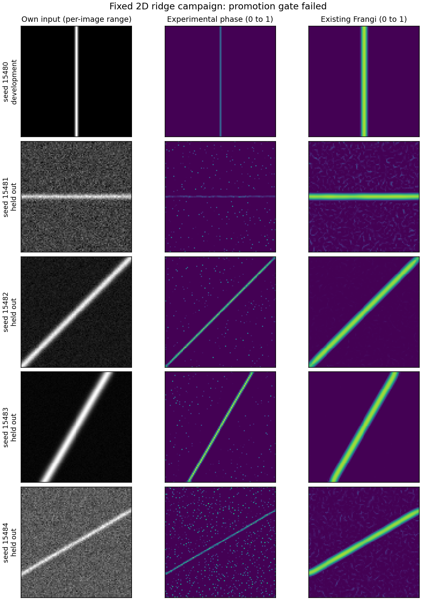

# Experimental isotropic wavelets and phase in 2D

`imagefilter.DecomposeWavelet2D`, `ReconstructWavelet2D` and `PhaseSymmetry2D`
provide an explicit research profile. They do not change any existing filter,
viewer setting or modality preset. The fixed ridge campaign below found **no
advantage over existing Frangi vesselness**, so the method remains experimental.
No clinical/default UI integration or automatic processing is justified by it.

## Mathematical and physical contract

The family is an undecimated radial Gaussian-difference partition. At physical
frequency vector omega (radians/mm), define `G(s)=exp(-s² |omega|²/2)`. Given
strictly increasing positive sigmas in millimetres, the first band is
`1-G(s0)`, subsequent bands are `G(previous)-G(current)`, and the residual is
`G(last)`. Their transfer functions sum to one, including DC. Reconstruction
sums the stored bands/residual in float64, rounding once to float32. This is a
redundant analysis bank with an identity/highpass endpoint, not an orthogonal,
decimated or energy-preserving wavelet transform. Coefficients retain input
scalar units. No denoising or coefficient thresholding is performed.

Phase uses the same bands as even filters and the two monogenic Riesz
quadratures with multipliers `-i omega_x/|omega|` and `-i omega_y/|omega|`.
DC is zero. Each Riesz axis is zero on its own sampled Nyquist line to preserve
Hermitian symmetry; Nyquist samples cannot define a unique odd quadrature.
The odd magnitude is `hypot(Rx,Ry)`, amplitude is `hypot(even,odd)`, and the
score is `sum(max(polarity(even)-odd-T,0))/sum(amplitude)`. Polarity selects
absolute even, positive even (bright), or negative even (dark). `T` is an
explicit per-band threshold in input units; noise statistics are not inferred.
This even/odd symmetry principle follows [Kovesi's primary paper](https://www.peterkovesi.com/papers/ai97.pdf);
the isotropic Riesz construction follows [Felsberg and Sommer](https://www.diva-portal.org/smash/get/diva2%3A241550/FULLTEXT01.pdf).
Implementation and fixtures are independent; no reference implementation was
copied. ITK's referenced oriented log-Gabor bank is a different numerical
contract and is not claimed as an oracle for this Gaussian-difference family.

`Phase` reports `atan2(odd,even)` at the strongest-amplitude band in [0,pi].
It is unsigned, folded phase; there is no spatial unwrapping or directional bin
bank. Ties retain the finest band. `ScaleMM` reports that band's declared sigma.
`Symmetry` is dimensionless in [0,1], not probability or anatomical confidence.
Amplitude retains input units. Where summed amplitude is at/below the explicit
floor (default 1e-12), `Valid=false`; phase, score and selected scale are zero.
Invalid phase is not presented as a meaningful angle. Ideal contrast scaling
is invariant only when threshold/floor scale too (or stay inactive); changing
contrast can also change float32 quantization and signal-to-noise ratio.

Only regular `Volume` grids with depth one and at least two samples in each
in-plane axis are accepted. X/Y spacing and sigmas are finite in [1e-9,1e9] mm.
Anisotropic spacing enters the frequency coordinates, so the bank is radial in
physical space. Dims and all spacing fields are copied exactly; origin,
orientation and acquisition-unit metadata remain with the caller, consistently
with `imagefilter.Volume`. Irregular geometry must be regularized by its owner.
Input/options must not be mutated concurrently and inputs remain unchanged.

## Extension, precision and resource limits

`WaveletPeriodic` requires radix-2 source dimensions and makes opposite source
edges adjacent explicitly. The default `WaveletReflect` places the input behind
a six-largest-sigma margin on each side, reflects without repeated endpoints,
then extends that pattern to radix-2 dimensions. It crops each result to the
original extent. The FFT is still periodic on this padded finite domain:
Gaussian seam effects are reduced, while the nonlocal Riesz transform can still
see the seam. This is not an infinite-domain or exact Neumann boundary claim.
Zero-padding is not silently substituted.

The existing cancellable radix-2 FFT uses float64 complex arithmetic; outputs
are float32. NaN/Inf inputs and incompatible coefficient geometry/metadata are
refused. Arithmetic outside float32 range returns `ErrPhase2DNumeric`, without
clipping a partly valid output. Reconstruction is qualified to maximum absolute
error `2e-6 * max(1,max(abs(source)))`; analytic Fourier transfer/phase checks use
2e-6 absolute tolerance. Arbitrary inversion of edited coefficients need not
recover the source and does not establish feature validity.

Finite default/hard ceilings are 2^20 source pixels, 2^22 padded pixels, eight
bands and 256 MiB of owned numeric payload. Callers may lower each limit.
Admission occurs before FFT/output allocation and accounts for the two complex
planes, one column of scratch per FFT worker, requested float32 outputs, phase
accumulators and validity mask. Metadata reports scratch/total logical working
bytes and the FFT worker bound; slice headers, allocator rounding and runtime
overhead are not an RSS guarantee. An oversized reflection margin is refused
before radix-2 allocation. The FFT rows and columns run in parallel on the
calling goroutine plus shared-budget helpers, at most one worker per 2^18
padded pixels and at most `Wavelet2DOptions.Workers` when nonzero;
padded planes below 2^19 pixels stay on one worker. Every line is transformed
exactly as serially, so outputs do not depend on the worker count. Filtering,
cropping and phase assembly are serial.

Cancellation is checked during input validation, FFT stages, rows, output
assembly and the final checkpoint. Private scratch is discarded; no partial
result accompanies cancellation. Existing FFT callers and filters are unchanged.
This is numerical 2D preparation and adds no application 3D CPU rendering.

## Fixed Windows evaluation

[The preregistered plan and artifacts](../imagefilter/testdata/phase1548/README.md)
use one development case and four distinct held-out Gaussian ridges with
different widths, angles, contrasts and fixed-seed noise. Scales are 1/2/4 mm.
The phase and existing Frangi thresholds are both 0.35; phase subtraction is
0.03 input units, floor 1e-6, bright polarity. Frangi keeps its existing
automatic per-scale structureness parameter and one worker. No parameter was
retuned after observing results. Positive/negative pixels and evaluation radius
are fixed in the plan; intermediate pixels are excluded from false-positive
counts. This is a narrow synthetic task, not anatomical/clinical qualification.

Windows 11 amd64 (kernel build 26200), Intel i7-14700K, Go 1.26.4,
GOMAXPROCS 4. Algorithms use one worker. QPC frequency is 10 MHz.

| Held-out seed | Phase recall | Frangi recall | Phase FPR | Frangi FPR | Phase peak localization |
| --- | ---: | ---: | ---: | ---: | ---: |
| 15481 | 1.04% | 100% | 0.216% | 0% | 8.5 pixels |
| 15482 | 76.0% | 100% | 0% | 0% | approximately 0 pixels |
| 15483 | 100% | 100% | 0% | 0% | 0.0131 pixels |
| 15484 | 48.61% | 100% | 1.521% | 0% | 0.0131 pixels |
| Pooled counts | **54.12%** | **100%** | **0.484%** | **0%** | median 0.0131 pixels |

The development case's phase recall was 0% at the fixed threshold; Frangi's was
100%. The favorable median location hides the low-contrast case's 8.5-pixel
error, so both individual and pooled measurements are retained. The promotion
gate required at least five percentage points more recall, FPR increase at most
one point, median location at most one pixel, working payload at most 64 MiB and
less than two seconds/image. Resource limits passed; the recall gate failed.
The evidence does not justify expanding dimensions/orientations or presets.

QPC observed phase calls at 22.32–23.35 ms versus Frangi at 1.47–1.57 ms on the
five 96×96 inputs. Phase reserved 2,626,584 logical bytes and allocated roughly
2,643,832–2,643,888 bytes/call. A separate three-by-three benchmark recorded
22.34–22.75 ms/op, approximately 2,643,800 B/op and 19 allocations/op. Whole
native test-process sampled peak working set was 30,437,376 bytes (10 ms poll,
six samples); this includes inputs, both filters, serialization and the cancelled
512×512 call, and is not per-kernel RSS. That call returned nil after cancellation
in 11.5 microseconds in the native run; one earlier observation was 374.2
microseconds. These host observations are not universal latency bounds.

NumPy 2.5.2 independently computed the declared frequency bank and Riesz score
on every stored input. All five float32 score maps agreed exactly; maximum
reconstruction error was 2.3842e-7 input units, within the preset tolerance.
Analytic tests cover constants, impulses, sinusoids, physical anisotropy,
polarity, contrast, Nyquist, invalid/near-null amplitudes, ownership, budgets,
incompatible geometry and cancellation including the final checkpoint.

